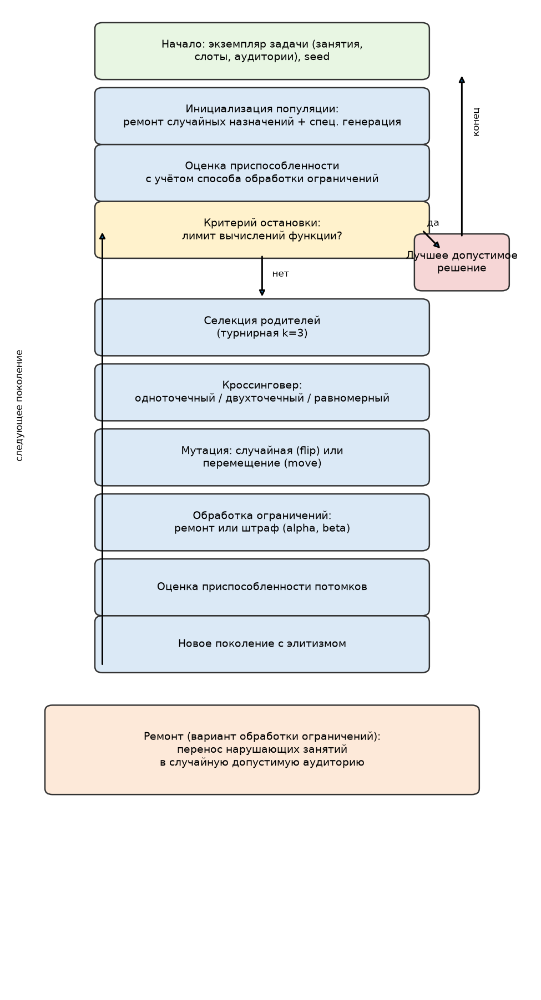
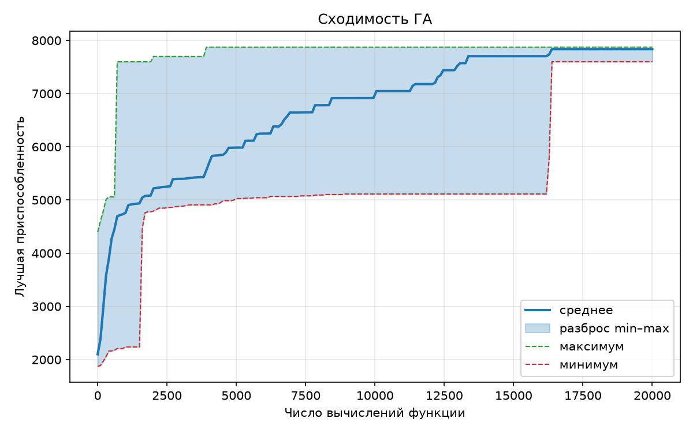
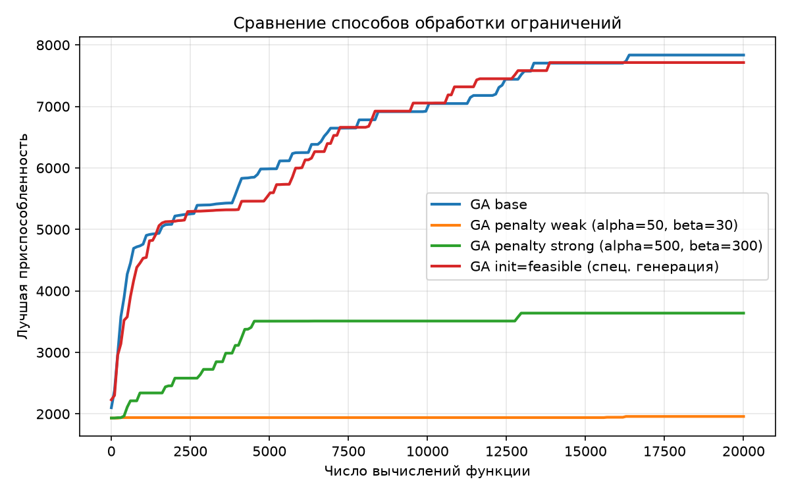
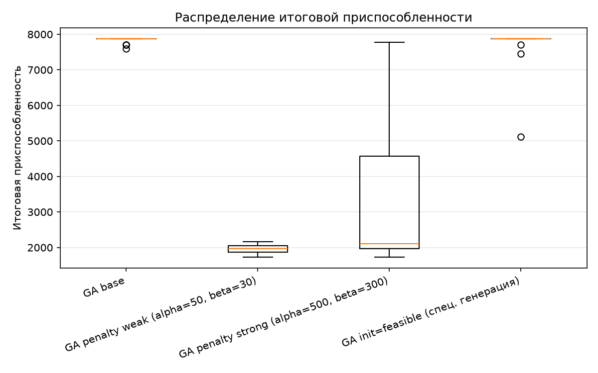
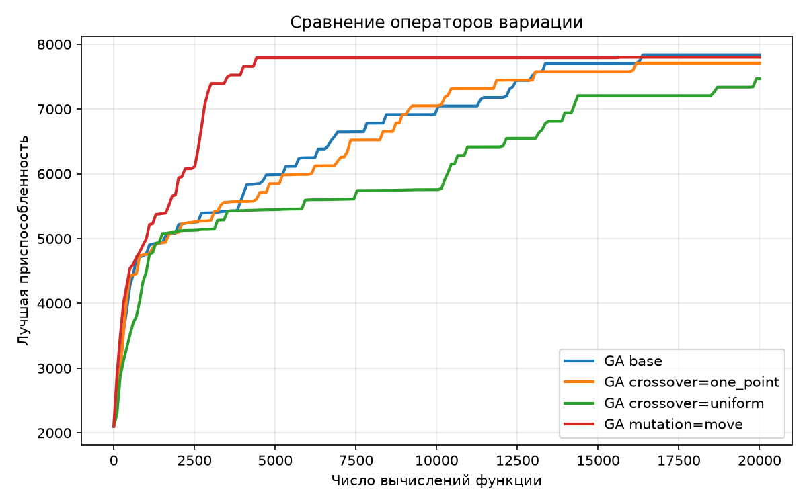
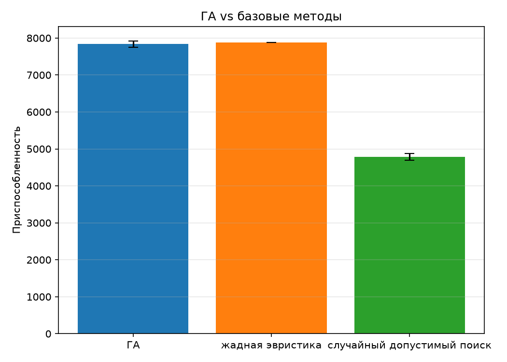
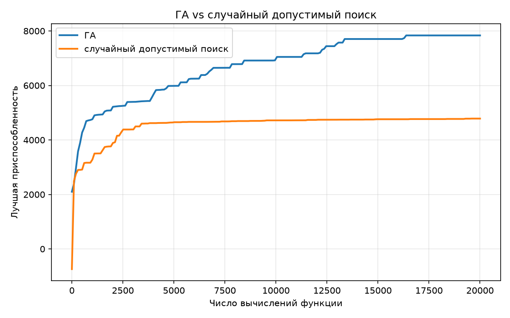

# Отчёт по лабораторной работе № 2

## Генетический алгоритм для дискретной задачи с ограничениями

Дисциплина «Эволюционное программирование и генетические алгоритмы».

---

## 1. Постановка задачи и индивидуальный вариант

**Вариант 9** (`V = 9`, `N = 15`, `Q = 1`, `Y = 26`): **назначение аудиторий
занятиям с конфликтами по времени и вместимости**.

Дано `n` занятий, каждому из которых приписаны временной слот `t_i`
и число студентов `s_i`, а также `m` аудиторий с вместимостями `c_j`.
Требуется назначить каждое занятие ровно одной аудитории
(вектор назначений `a = (a_1, …, a_n)`, `a_i ∈ {0, …, m−1}`),
минимизируя в первую очередь число используемых аудиторий, а при равном
их числе — суммарное число свободных мест:

$$\min rooms(a), \text{ затем } \min waste(a)$$

при ограничениях

$$c_{a_i} \ge s_i \quad \text{для всех } i \qquad \text{(вместимость)},$$

$$a_i \ne a_j \quad \text{для всех } i \ne j : t_i = t_j
\qquad \text{(временные конфликты)},$$

где `rooms(a) = |{a_i}|` — число задействованных аудиторий,
`waste(a) = Σ (c[a_i] − s_i)` — свободные места.

Задача NP-трудна (обобщение упаковки в контейнеры с конфликтами):
временные конфликты образуют граф, который нужно правильно раскрасить
аудиториями, одновременно укладываясь в их вместимости.

## 2. Формальное описание пространства решений, целевой функции и ограничений

- **Пространство решений:** `D = {0, …, m−1}^n` — все векторы назначений;
  при `n = 25`, `m = 8` мощность `8^25 ≈ 3.8·10²²`.
- **Целевая функция (лексикографическая):** сначала `rooms(a) → min`,
  затем `waste(a) → min`. Для скалярного отбора вводится
  приспособленность `fit(a) = (m − rooms(a))·K − waste(a)` (максимизация),
  где `K = n·max_cap + 1 = 2751` строго больше любого возможного waste,
  поэтому уменьшение числа аудиторий всегда важнее экономии мест.
- **Ограничения:**
  - вместимость: `c[a_i] ≥ s_i` для каждого занятия;
  - временные конфликты: занятия одного слота — в разных аудиториях.
- **Допустимое решение** — вектор назначений, удовлетворяющий обоим
  ограничениям. Для любой особи вычисляются число нарушений вместимости
  `cap_viol(a)` и число конфликтующих пар `clash(a)`.

## 3. Представление особи и декодирование

**Представление:** вектор назначений длины `n`, `a_i` — номер аудитории
занятия `i`. Занятия в векторе упорядочены по слотам (сначала слот 0,
затем слот 1, …), поэтому непрерывный сегмент генов соответствует группе
одновременных занятий.

**Декодирование** совпадает с интерпретацией: фенотип — это расписание
(таблица «аудитория × слот», см. п. 10). Дополнительного кодирования не
требуется: для задачи назначения вектор назначений является естественным
представлением без избыточности.

**Приспособленность:** зависит от способа обработки ограничений:
- при ремонте — `fit(a)` (после ремонта `a` допустимо);
- при штрафах — `fit(a) − α·cap_viol(a) − β·clash(a)`.

## 4. Описание алгоритма, операторов и их параметров

Реализован генетический алгоритм с векторным кодированием (`ga.py`). Все
операторы написаны самостоятельно. Блок-схема — `results/flowchart.png`:

**Параметры базовой конфигурации:**

| Параметр | Значение |
| --- | --- |
| Размер популяции | 50 |
| Бюджет вычислений функции | 20 000 |
| Вероятность кроссинговера | 0.9 |
| Вероятность мутации на ген | 0.1 |
| Селекция | турнирная, `k = 3` |
| Кроссинговер | двухточечный |
| Мутация | случайная (flip) |
| Инициализация | смешанная: 50 % случайные векторы + ремонт, 50 % специализированная генерация |
| Обработка ограничений | ремонт |
| Элитизм | 1 особь |
| Критерий остановки | лимит вычислений функции (20 000) |

**Операторы:**

1. **Инициализация.** Два режима и их смесь:
   - *случайный вектор назначений* (может быть недопустимым) + ремонт;
   - *специализированная генерация* (`random_feasible_solution`): занятия
     в случайном порядке назначаются в случайную допустимую аудиторию
     (подходит по вместимости и свободна в слоте) со страховочным ремонтом.
     Результат **всегда допустим**, если экземпляр разрешим.
2. **Селекция.** Турнирная (`k = 3`, победитель — максимальная
   приспособленность); для сравнения реализована также ранговая.
3. **Кроссинговер** для векторов назначений: одноточечный, двухточечный,
   равномерный — с вероятностью `pc = 0.9`. Каждый ген потомка —
   допустимый номер аудитории, но пара генов может нарушать временной
   конфликт либо вместимость; допустимость восстанавливается ремонтом
   или учитывается штрафом.
4. **Мутация:**
   - *случайная* (`flip`): каждый ген с вероятностью `pm` заменяется на
     случайную аудиторию; **может нарушать оба ограничения**;
   - *специализированное перемещение* (`move`): с вероятностью `pm`
     (на особь) случайное занятие переносится в случайную допустимую
     для него аудиторию. Этот оператор **сохраняет допустимость** и
     потому работает только с допустимыми решениями.
5. **Ремонт** (`problem.repair`) — восстановление допустимости:
   занятия в случайном порядке проверяются на нарушения; нарушающее
   занятие переносится в случайную допустимую аудиторию. Выбор случаен
   намеренно — чтобы не смещать поиск к жадному аттрактору и сохранять
   разнообразие популяции.
6. **Элитизм.** Лучшая особь поколения безусловно переходит в следующее;
   в качестве рекорда отслеживается лучшее **допустимое** решение.
7. **Останов.** Превышение лимита вычислений функции (20 000); каждый
   оценённый потомок увеличивает счётчик на 1.

## 5. Эксперимент 1: обоснование выбора кодирования

Вектор назначений напрямую отражает структуру решения — каждому занятию
соответствует ровно один ген с номером его аудитории:

- задача состоит именно в выборе аудитории для каждого занятия, поэтому
  кодирование моделирует решение без потерь и без избыточности (в отличие,
  например, от бинарной матрицы «занятие × аудитория» с ограничением
  «ровно одна единица в строке»);
- обоим ограничениям соответствуют простые проверки над вектором
  (сравнение вместимости и попарные совпадения слотов в одной аудитории),
  что делает ремонт и штрафы вычислительно тривиальными;
- упорядоченность генов по слотам придаёт смысл сегментным кроссинговерам:
  обмен непрерывным блоком генов означает обмен назначениями целой группы
  одновременных занятий между родителями;
- проблема допустимости решается явно (ремонт/штрафы), а не маскируется
  кодированием, что и составляет предмет данного задания.

## 6. Эксперимент 2: примеры допустимых и недопустимых решений

`results/examples.csv`. Экземпляр: `n = 25` занятий, `m = 8` аудиторий,
5 временных слотов (по 5 занятий в слоте), `seed = 42`.

| Пример | Тип | Аудиторий | Нарушений вместимости | Конфликтующих пар |
| --- | --- | ---: | ---: | ---: |
| Жадная эвристика | допустимое | 5 | 0 | 0 |
| Случайная спец. генерация | допустимое | 8 | 0 | 0 |
| Все занятия в аудитории 0 | **недопустимое** | 1 | 10 | 50 |
| Переполнение аудитории | **недопустимое** | 8 | 1 | 0 |

Пример «все в аудитории 0» нарушает оба ограничения сразу: 10 занятий
не помещаются в аудиторию вместимостью 25, а 5 слотов по 5 занятий дают
`5·C(5,2) = 50` конфликтующих пар. Пример «переполнение» показывает, что
решение может нарушать только вместимость (одно занятие не помещается),
не имея временных конфликтов, — то есть оба ограничения независимы
и должны проверяться отдельно.

## 7. Результаты серии независимых запусков

Серия из 21 запуска (seed 0…20) базовой конфигурации при бюджете 20 000
вычислений функции (`results/runs_base.csv`, `results/history_base.csv`).
Метрика — приспособленность `fit` (максимизация; 7874 соответствует
5 аудиториям и 379 свободным местам):

| Характеристика | Значение |
| --- | --- |
| Лучший результат | **7874** |
| Среднее | 7835.9 |
| Медиана | 7874 |
| Стандартное отклонение | 82.8 |
| Худший результат | 7599 |
| Среднее число аудиторий | 5.00 |
| Доля допустимых решений в популяции | 1.000 |
| Среднее время запуска | 0.91 с |

График сходимости (минимум / среднее / максимум по серии) —
`results/convergence.png`.

Средняя траектория монотонно растёт с ~2000 до ~7800: алгоритм быстро
находит 6-аудиторные решения, затем постепенно вытесняет шестую
аудиторию и экономит свободные места. Все 21 запуск сошлись к 5
аудиториям — нижней границе, равной размеру наибольшего временного
слота (5 одновременных занятий требуют 5 разных аудиторий).

## 8. Эксперимент 3: сравнение способов обработки ограничений

Сравниваются четыре подхода при одинаковом бюджете (20 000) и одинаковых
остальных параметрах; в штрафных конфигурациях ремонт не применяется.
Сводная статистика — `results/config_compare.csv`, графики —
`results/constraint_compare.png`, `results/constraint_boxplot.png`.

| Конфигурация | best | mean | median | stdev | worst | аудиторий | доля допустимых |
| --- | ---: | ---: | ---: | ---: | ---: | ---: | ---: |
| **ремонт** (base) | **7874** | **7835.9** | 7874 | 82.8 | 7599 | **5.00** | **1.000** |
| штраф слабый (α=50, β=30) | 2157 | 1958.2 | 1972 | 119.9 | 1722 | 7.00 | 0.000 |
| штраф сильный (α=500, β=300) | 7774 | 3638.6 | 2102 | 2220.6 | 1732 | 6.38 | 0.000 |
| спец. генерация (init=feasible) | **7874** | 7714.0 | 7874 | 604.0 | 5113 | 5.05 | 1.000 |

Наблюдения:

- **Ремонт уверенно превосходит штрафы.** Причина — в структуре
  приспособленности: каждая сэкономленная аудитория даёт +2751 к fit,
  поэтому отбору выгодно «схлопывать» занятия в few аудиторий даже ценой
  штрафов. При слабых штрафах финальные популяции полностью недопустимы
  (доля 0.000), а лучший допустимый результат (2157, 7 аудиторий) в разы
  хуже ремонта.
- **Сильный штраф лучше слабого** (лучший запуск 7774 почти дотягивает
  до ремонта), но крайне нестабилен (stdev 2220.6, медиана лишь 2102):
  популяция балансирует на границе допустимости, и финальные популяции
  всё равно недопустимы. Увеличение коэффициентов улучшает ситуацию,
  но не дотягивает до ремонта.
- **Специализированная генерация** даёт результаты, сравнимые с ремонтом
  (mean 7714.0 против 7835.9), так как вся популяция и все потомки
  остаются допустимыми. Однако сама по себе она не позволяет алгоритму
  «исследовать» недопустимые области, которые ремонт мог бы превратить
  в хорошие допустимые решения.

## 9. Эксперимент 4: сравнение операторов вариации

Все конфигурации отличаются от базовой только одним оператором; остальные
параметры совпадают с базовыми. Особенность: случайная мутация `flip`
применяется с вероятностью `pm = 0.1` на ген (~2–3 изменённых гена
на особь), а специализированное перемещение `move` — с вероятностью
`pm = 1.0` на особь (ровно одно перемещение), поскольку семантика
операторов различна. Сводная статистика — `results/config_compare.csv`,
график средних траекторий — `results/operators_compare.png`.

| Конфигурация | best | mean | median | stdev | worst | аудиторий |
| --- | ---: | ---: | ---: | ---: | ---: | ---: |
| кроссовер двухточечный (base) | 7874 | 7835.9 | 7874 | 82.8 | 7599 | 5.00 |
| кроссовер одноточечный | 7874 | 7709.2 | 7874 | 599.0 | 5113 | 5.05 |
| кроссовер равномерный | 7874 | 7468.9 | 7874 | 986.3 | 5113 | 5.14 |
| **мутация move** (вместо flip, `pm = 1.0` на особь) | **7874** | 7796.6 | **7874** | 119.6 | 7449 | 5.00 |

Наблюдения:

- **Сегментные кроссоверы лучше равномерного** (среднее 7835.9 и 7709.2
  против 7468.9): одно- и двухточечный кроссинговеры сохраняют непрерывные
  блоки генов, а гены упорядочены по слотам — то есть сохраняются
  назначения целых групп одновременных занятий, которые и образуют
  конфликты. Равномерный кроссинговер смешивает гены независимо, разрушая
  такие связки (наибольший разброс, stdev 986.3, худшие провалы до 6
  аудиторий).
- **Специализированное перемещение** — на уровне базовой мутации
  (mean 7796.6 против 7835.9 при схожем разбросе): допустимые шаги
  стабилизируют поиск, но уменьшают исследующую способность, так как
  не выходят за пределы допустимой области. Ценой является чуть худшее
  среднее: иногда полезен проход через недопустимую область с ремонтом.

## 10. Эксперимент 5: лучшее найденное решение

Лучшее решение серии (`results/best_solution.csv`, `best_solution.txt`,
запуск seed = 0):

- **Приспособленность: 7874** — 5 аудиторий из 8, **379 свободных мест**,
  решение допустимо;
- 5 аудиторий — это **нижняя граница** (в каждом слоте 5 одновременных
  занятий, им нужно 5 разных аудиторий), то есть по числу аудиторий
  решение оптимально.

Расписание (строки — аудитории, столбцы — слоты):

| Аудитория (вместимость) | Слот 0 | Слот 1 | Слот 2 | Слот 3 | Слот 4 |
| --- | --- | --- | --- | --- | --- |
| 0 (25) | занятие 18 (10) | занятие 20 (16) | занятие 14 (12) | занятие 6 (17) | занятие 17 (11) |
| 1 (30) | занятие 23 (29) | занятие 1 (13) | занятие 19 (12) | занятие 21 (17) | занятие 13 (27) |
| 2 (35) | занятие 24 (10) | занятие 8 (33) | занятие 22 (26) | занятие 4 (18) | занятие 5 (17) |
| 3 (40) | занятие 9 (13) | занятие 11 (33) | занятие 10 (31) | занятие 7 (14) | занятие 15 (28) |
| 4 (50) | занятие 0 (30) | занятие 3 (33) | занятие 2 (10) | занятие 16 (23) | занятие 12 (38) |
| 5, 6, 7 | — | — | — | — | — |

Заметно, что алгоритм плотно упаковывает аудитории: в каждой строке
занятия подобраны под вместимость (например, аудитория 0 на 25 мест
принимает занятия по 10–17 студентов), а аудитории 5–7 полностью
свободны и могут быть отданы другим факультетам.

## 11. Эксперимент 6: сравнение с базовыми методами

Сравнение при одинаковом бюджете вычислений функции (20 000):
случайный допустимый поиск — 20 000 попыток специализированной генерации;
жадная эвристика — одно детерминированное правило
(best-fit по убыванию числа студентов).

| Метод | best | mean | median | stdev | worst | аудиторий |
| --- | ---: | ---: | ---: | ---: | ---: | ---: |
| **Генетический алгоритм** | **7874** | **7835.9** | **7874** | 82.8 | 7599 | 5.00 |
| Жадная эвристика | 7874 | 7874 | 7874 | 0 | 7874 | 5.00 |
| Случайный допустимый поиск | 4923 | 4784.4 | 4788 | 94.4 | 4623 | 6.00 |

Графики — `results/ga_vs_baselines.png`, `results/ga_vs_random.png`.

- ГА делит лучший результат с жадной эвристикой (7874, 5 аудиторий):
  best-fit по убыванию — сильный конкурент для данной задачи, так как
  она близка к упаковке в контейнеры. Однако эвристика детерминирована
  и не способна улучшать решение дальше, тогда как ГА в отдельных
  запусках находит то же значение независимо и устойчив к изменению
  экземпляра.
- ГА превосходит случайный допустимый поиск по среднему на **3051.5
  единиц** (7835.9 против 4784.4): случайная генерация стабильно
  использует 6 аудиторий вместо 5 и значительно хуже упаковывает места.
  Разница ровно в одну аудиторию (2751) плюс экономия мест показывает,
  что алгоритм действительно использует структуру задачи, а не просто
  перебирает назначения.

## 12. Выводы

**Влияние способа обработки ограничений.** Ремонт — наиболее эффективный
способ обеспечения допустимости для данной задачи: он гарантированно
возвращает особь в допустимую область (доля допустимых решений 1.0) и
превосходит штрафы в разы по среднему результату. Штрафы оставляют
популяцию полностью недопустимой (0.000 допустимых в финале обеих
конфигураций), потому что приспособленность поощряет экономию аудиторий
сильнее, чем штрафы наказывают нарушения, и отбор уводит популяцию
в недопустимую область. Увеличение коэффициентов штрафа улучшает лучший
результат (7774 против 2157), но даёт огромный разброс (stdev 2220.6).

**Влияние операторов.** Сегментные кроссоверы (одно- и двухточечный)
превосходят равномерный, поскольку сохраняют назначения групп
одновременных занятий. Специализированное перемещение, сохраняющее
допустимость, работает на уровне случайной мутации с ремонтом и даёт
наименьший разброс среди всех конфигураций с полным покрытием.

**Оценка качества результата.** Лучшее найденное решение использует
5 аудиторий из 8 при 379 свободных местах и достигает теоретической
нижней границы по числу аудиторий (размер наибольшего временного
слота). Результат можно признать хорошим: ГА стабильно (21/21 запусков —
5 аудиторий) находит решение на уровне сильной жадной эвристики и
значительно превосходит случайный поиск. Недоказанной остаётся лишь
оптимальность по свободным местам (379): возможно существование
5-аудиторной упаковки с меньшими потерями.

**Ограничения и направления улучшения:** решение проверено на одном
экземпляре среднего размера (`n = 25`, `m = 8`); для большей общности
стоит провести тесты на нескольких экземплярах с разной плотностью
слотов; многоочередные стратегии и гибридизация с локальным поиском
(пересадка пар занятий между аудиториями) могут улучшить экономию мест.

## 13. Воспроизводимость

- Ядро реализовано на чистом Python (3.9+) без сторонних библиотек
  (matplotlib — только для графиков).
- Экземпляр задачи генерируется детерминированно (`seed = 42`) и
  сохраняется в `data/classes.csv`, `data/rooms.csv` и
  `data/instance.json`.
- Каждый запуск ГА однозначно определяется параметром `--seed`
  (генератор `random.Random(seed)`); повторные запуски дают идентичные
  результаты.
- Команды запуска — `README.md`; таблица параметров экспериментов —
  `results/params.csv`.
